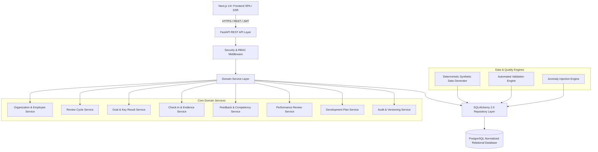

# Architecture Design Document: YottaPerf Platform

## 1. System Overview

YottaPerf is an enterprise-grade Employee Performance Management and Development Platform designed with a clean, decoupled, layered architecture. The platform orchestrates the complete employee performance lifecycle:
- Organization hierarchy & manager relationships with historical tracking.
- Bi-annual/quarterly review cycles with strict lifecycle governance.
- OKRs & Goals with mathematically derived Key Result progress tracking.
- Periodic check-ins and evidence tracking.
- 360-degree Competency Feedback (Self, Manager, Peer).
- Transparent, weighted performance reviews and approval workflows.
- Competency-gap-driven Employee Development Plans.
- Automated Anomaly Injection, Ground Truth generation, and Validation Engine.
- Immutable Audit Trails and Version Histories.

## 2. Layered Architecture

1. **Presentation Layer (Frontend)**:
   - Next.js (App Router), React 18, TypeScript, Tailwind CSS.
   - Analytics powered by Recharts.
   - Unified API client with automatic JWT token management.
   - Responsive, enterprise design system with accessible components.

2. **API & Interface Layer (FastAPI)**:
   - RESTful endpoints adhering to OpenAPI 3.1 specifications.
   - Pydantic v2 schemas for strict input/output serialization and validation.
   - HTTP status code rigor (200, 201, 400, 401, 403, 404, 409, 422).
   - Global exception handling and structured error responses.

3. **Security & RBAC Layer**:
   - JWT bearer token authentication with cryptographically secure PBKDF2/Bcrypt password hashing.
   - Five distinct roles: `EMPLOYEE`, `MANAGER`, `HR_PARTNER`, `IT_OPS`, `ADMIN`.
   - Granular permission evaluators verifying object ownership, managerial hierarchy, and lifecycle state.

4. **Domain Service Layer**:
   - Encapsulates all business rules, mathematical computations, and transaction boundaries.
   - Prevents circular reporting hierarchies via cycle-detection algorithms (DFS / Floyd-Warshall).
   - Computes weighted Key Result progress and reconciled review scores.
   - Enforces lifecycle state machine transitions.

5. **Persistence Layer (SQLAlchemy 2.0)**:
   - Normalized 3NF PostgreSQL relational schema.
   - Bridge tables for many-to-many associations.
   - Composite unique constraints, foreign keys with referential actions (`CASCADE`, `RESTRICT`).
   - Native support for SQLite in testing and PostgreSQL in production/Docker.

6. **Data Quality & Anomaly Engine**:
   - Seed-based deterministic synthetic data generation engine (`seed=20261022`).
   - Controlled anomaly injection with separated ground-truth dataset.
   - Automated 15-point relational validation engine.

## 3. Technology Stack & Component Versioning

| Component | Technology | Version | Purpose |
|---|---|---|---|
| Backend Framework | FastAPI | >= 0.110.0 | High-performance asynchronous REST API |
| ORM | SQLAlchemy | >= 2.0.28 | Modern typed relational ORM |
| Migrations | Alembic | >= 1.13.0 | Schema evolution & database versioning |
| Data Validation | Pydantic | >= 2.6.0 | Schema validation and serialization |
| Relational DB | PostgreSQL | 16-alpine | Enterprise ACID relational store |
| Synthetic Engine | NumPy / Faker / Pandas | Compatible | Deterministic generation & data export |
| Testing | Pytest / TestClient | >= 8.0.0 | Unit, integration & regression test suite |
| Frontend Framework | Next.js | 14+ | App Router, SSR, and dynamic client routing |
| Language | TypeScript | 5.x | Static typing across UI components |
| Styling | Tailwind CSS | 3.4.x | Utility-first modern responsive UI |
| Visualizations | Recharts | 2.12.x | Enterprise analytics and metric dashboards |
| Containerization | Docker & Compose | 3.8+ | Standardized multi-container deployment |
