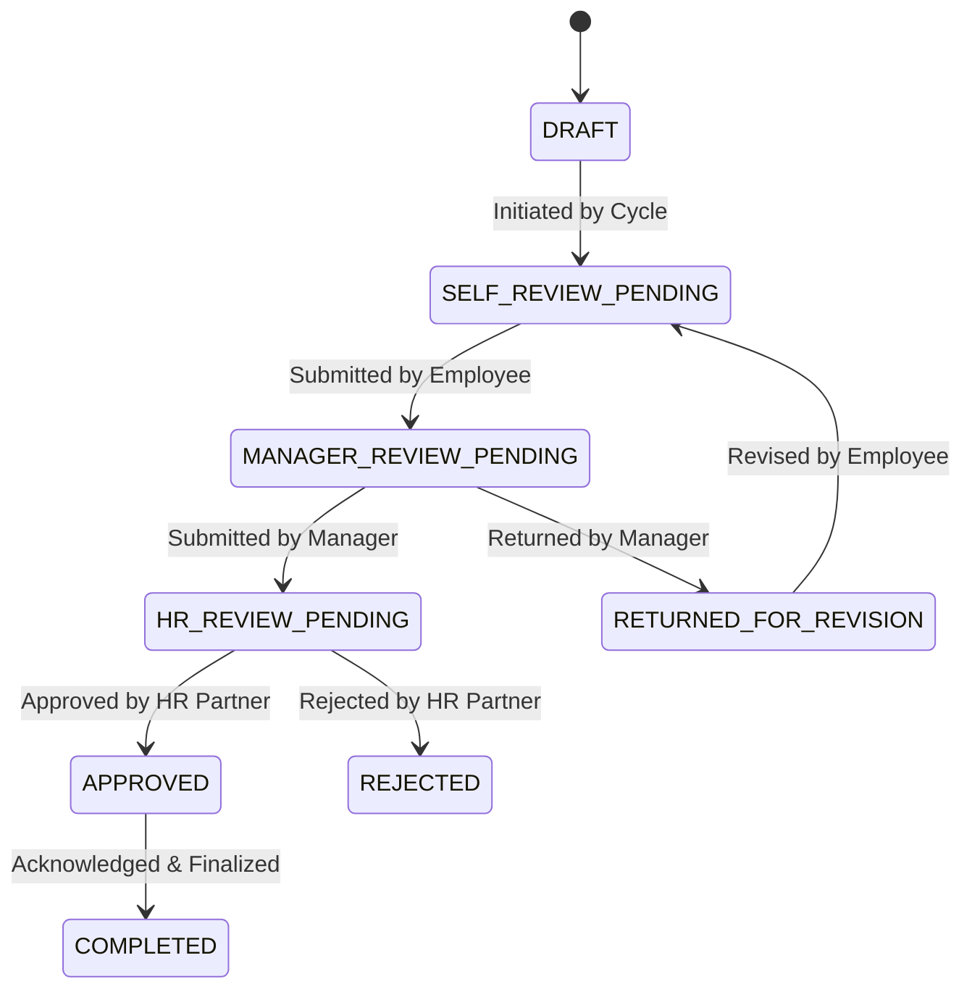

# Business Rules & Workflow Specification: YottaPerf Platform

This document specifies the exact business rules, mathematical formulas, state machine transitions, and RBAC policies governing the YottaPerf platform.

---

## 1. Organization & Reporting Hierarchy Rules

### Rule 1.1: Circular Reporting Prevention
- An employee cannot report to themselves directly or indirectly through any chain of managerial relationships.
- Before committing any manager assignment or transfer, the system executes a cycle detection algorithm:
  - Directed acyclic graph (DAG) verification.
  - Traverse ancestral chain starting from proposed manager up to the organization root. If the target employee appears anywhere in the ancestor chain, reject with HTTP 400 (`CIRCULAR_HIERARCHY_DETECTED`).

### Rule 1.2: Manager Effective Date Invariants
- Each employee has exactly one active manager record at any point in time (`effective_end_date IS NULL`).
- When transferring an employee to a new manager:
  1. The existing active `EmployeeManagerHistory` record is closed by setting `effective_end_date = transfer_effective_date`.
  2. A new `EmployeeManagerHistory` record is inserted with `effective_start_date = transfer_effective_date`.
  3. `employees.manager_id` is updated in the same atomic transaction.

---

## 2. Review Cycle Governance

### Rule 2.1: Lifecycle States
A review cycle moves through five sequential stages:
`UPCOMING` -> `OPEN` -> `EVALUATION` -> `CLOSED` -> `ARCHIVED`

- **OPEN**: Employees and managers can establish goals, submit check-ins, and gather feedback.
- **EVALUATION**: Goal creation is locked; review appraisals, self-reviews, and manager ratings are submitted.
- **CLOSED**: Immutable. All appraisal evaluations are finalized.
- **ARCHIVED**: Read-only historical storage.

### Rule 2.2: Closed Cycle Immutability & Emergency Corrections
- Direct modifications to goals, reviews, or feedbacks tied to a `CLOSED` or `ARCHIVED` cycle are strictly rejected.
- Administrative overrides require:
  1. Role = `ADMIN` or `HR_PARTNER`.
  2. Mandatory justification `reason` provided.
  3. An explicit `AuditEvent` created documenting old and new payloads.

---

## 3. Goals and Key Results Calculation Rules

### Rule 3.1: Key Result Progress Formulas
Key Result progress is mathematically calculated from raw source observations:

#### Case A: Increasing Metric (`metric_direction == 'INCREASING'`)
Where the goal is to grow a metric from `baseline` to `target` (e.g., Target > Baseline):
$$ \text{progress} = \frac{\text{current} - \text{baseline}}{\text{target} - \text{baseline}} \times 100 $$

#### Case B: Decreasing Metric (`metric_direction == 'DECREASING'`)
Where the goal is to reduce a metric from `baseline` to `target` (e.g., Target < Baseline, such as latency or defects):
$$ \text{progress} = \frac{\text{baseline} - \text{current}}{\text{baseline} - \text{target}} \times 100 $$

#### Edge Cases & Defensive Invariants:
1. **Zero Denominator ($target = baseline$)**:
   - If $current \ge target$, $\text{progress} = 100.0\%$.
   - Else, $\text{progress} = 0.0\%$.
2. **Values Exceeding Target**:
   - Normal scale is bounded between $0.0\%$ and $100.0\%$. If current performance exceeds target, progress can reflect up to $150.0\%$ overachievement if approved, but uncapped or unbounded values (>200%) trigger validation scrutiny.
3. **Values Regressing Below Baseline**:
   - Clamped to $0.0\%$ for baseline business progress reporting to prevent negative completion percentages.

### Rule 3.2: Weighted Goal Progress
A goal's overall progress is the weighted average of its active child Key Results:
$$ \text{Goal Progress} = \frac{\sum_{i=1}^{n} (\text{KR}_i.\text{progress\_percentage} \times \text{KR}_i.\text{weight})}{\sum_{i=1}^{n} \text{KR}_i.\text{weight}} $$
- A goal with no Key Results defaults to $0.0\%$.
- Never allow manual override of `calculated_progress` without updating underlying Key Results.

---

## 4. Check-Ins & Evidence Linking Rules

### Rule 4.1: Goal Scope Verification
- Check-ins can only be submitted for goals that are in `ACTIVE` status within an `OPEN` review cycle.
- The submitting user must be the goal owner or their direct manager.

### Rule 4.2: Evidence Substantiation
- High-impact progress jumps (>25% increment in a single check-in) require at least one attached `Evidence` reference (e.g., PR link, certification artifact, metric URL).

---

## 5. Competency & Feedback Rules

### Rule 5.1: Reviewer Relationship Eligibility
Feedback can only be submitted if an authentic organizational relationship exists between the reviewer and the subject employee:
1. **SELF**: Reviewer ID matches Subject ID.
2. **MANAGER**: Reviewer ID is the direct manager of the Subject employee.
3. **PEER**:
   - Reviewer belongs to the same department as Subject, OR
   - Reviewer shares the same manager, OR
   - Reviewer was explicitly designated in `review_permissions` for cross-functional collaboration.

Submission of peer feedback by an unrelated employee triggers `ANOMALY_INVALID_REVIEWER`.

### Rule 5.2: Non-Destructive Conflicting Feedback
- Multiple reviewers can evaluate the same competency for the same employee.
- Rather than overwriting, each feedback submission generates a distinct `Feedback` record.
- If manager and peer feedback diverge by $\ge 2.0$ points on a 5-point scale, the system flags a `DIVERGENT_FEEDBACK` calibration alert for HR review.

---

## 6. Performance Review Scoring & Lifecycle

### Rule 6.1: Configurable Transparent Scoring Formula
A performance review final score is computed as:
$$ \text{Final Score} = (S_{\text{goal}} \times W_{\text{goal}}) + (S_{\text{competency}} \times W_{\text{competency}}) + (S_{\text{feedback}} \times W_{\text{feedback}}) $$
Where default weights configured on `review_cycles` are:
- $W_{\text{goal}} = 50\% = 0.50$
- $W_{\text{competency}} = 30\% = 0.30$
- $W_{\text{feedback}} = 20\% = 0.20$

Normalized Scale:
- All component scores are mapped to a 100-point normalized index.
- Final rating categories:
  - $\ge 90.0$: `OUTSTANDING` (5.0 equivalent)
  - $\ge 75.0$ and $< 90.0$: `EXCEEDS_EXPECTATIONS` (4.0 equivalent)
  - $\ge 60.0$ and $< 75.0$: `MEETS_EXPECTATIONS` (3.0 equivalent)
  - $< 60.0$: `NEEDS_IMPROVEMENT` (2.0 / 1.0 equivalent)

### Rule 6.2: State Machine & Transition Permissions

- **Invariants**:
  - Employees cannot approve their own reviews.
  - Managers cannot approve reviews without completing manager evaluation comments.
  - HR Partner review is required before a review can reach `APPROVED` or `COMPLETED`.

---

## 7. Development Plans & Approvals

### Rule 7.1: Gap Identification Trigger
- Any competency rating in a finalized review that scores below $3.0 / 5.0$ automatically generates a competency gap recommendation.

### Rule 7.2: Dual-Approval Gate
- Development plans require manager approval (`PENDING` -> `APPROVED`).
- High-investment plans (budget or external courses) require secondary HR Partner sign-off.

---

## 8. Role-Based Access Control (RBAC) Matrix

| Entity / Action | EMPLOYEE | MANAGER | HR_PARTNER | IT_OPS | ADMIN |
|---|---|---|---|---|---|
| View Employee Profiles | Own + Team Directory | Direct Reports + Dept | All | System | All |
| Update Manager Assignment | Denied | Denied | Approved | Denied | Approved |
| Manage Review Cycles | Denied | Denied | Approved | Denied | Approved |
| Create / Edit Goal | Own Goals | Direct Reports + Own | View All | View All | All |
| Submit Check-In | Own Goals | Direct Reports | View All | View All | All |
| Submit Feedback | Self + Assigned Peers | Direct Reports | All | Denied | All |
| Approve Performance Review | Denied | Direct Reports | Calibrate All | Denied | All |
| Create Development Plan | Own | Direct Reports | All | Denied | All |
| Run Synthetic Generator | Denied | Denied | Denied | Authorized | Authorized |
| Run Relational Validator | Denied | Denied | Read-Only | Authorized | Authorized |
| Investigate Anomalies | Denied | Own Team | Authorized | Authorized | Authorized |
| View System Audit Logs | Denied | Denied | Compliance | Authorized | Authorized |
