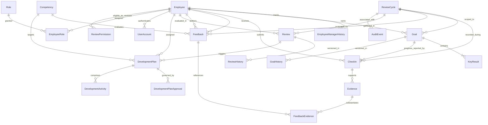

# Database Relationships and Entity-Relationship Architecture

## 1. Relational Entity Overview

The YottaPerf database adheres to Third Normal Form (3NF). All foreign keys enforce referential integrity with appropriate cascading rules. Deterministic string IDs are used across all entities (`EMP-000001`, `CYCLE-2026-H1`, `GOAL-EMP-000001-001`, `KR-GOAL-EMP-000001-001-01`, `CHK-000001`, `FB-000001`, `REV-2026-000001`, `DP-000001`, `EVD-000001`, `ANO-000001`).

## 2. Cardinality and Association Rules

### 2.1 One-to-One Relationships
- `Employee` <-> `UserAccount`: Each employee profile corresponds to at most one system authentication account (`user_accounts.employee_id` is unique).
- `Review` <-> `Employee` + `ReviewCycle`: Exactly one performance review per employee per review cycle (composite unique constraint on `(employee_id, review_cycle_id)`).

### 2.2 One-to-Many Relationships
- `Employee` (Manager) -> `Employee` (Direct Reports): An employee reports to at most one current manager (`manager_id` foreign key).
- `Employee` -> `EmployeeManagerHistory`: Historical manager assignments are tracked whenever an employee transitions or changes reporting structure.
- `ReviewCycle` -> `Goal`: Multiple goals belong to a given review cycle.
- `Goal` -> `KeyResult`: A goal has one or more quantifiable Key Results.
- `Goal` -> `GoalHistory`: Every status/weight/title modification creates an immutable snapshot.
- `Goal` -> `CheckIn`: Periodic progress reports submitted against specific goals.
- `Review` -> `ReviewHistory`: Every review stage transition (e.g., `SELF_REVIEW_PENDING` -> `MANAGER_REVIEW_PENDING`) captures author, notes, and timestamp.
- `DevelopmentPlan` -> `DevelopmentPlanApproval`: Each plan requires manager and/or HR approvals.
- `DevelopmentPlan` -> `DevelopmentActivity`: A plan contains multiple specific learning activities or courses.

### 2.3 Many-to-Many Bridge Tables
- `Employee` <-> `Role` via `employee_roles`: Bridges employee identities to RBAC security roles (`EMPLOYEE`, `MANAGER`, `HR_PARTNER`, `IT_OPS`, `ADMIN`).
- `Feedback` <-> `Evidence` via `feedback_evidence`: Binds multiple evidentiary artifacts to a given competency feedback item.
- `Reviewer` <-> `Reviewee` via `review_permissions`: Defines authorized peer and 360-feedback reviewer assignments for a given cycle.

## 3. Referential Integrity and Constraints
- Foreign keys use `ON DELETE RESTRICT` for primary business records (`employees`, `review_cycles`, `goals`, `reviews`) to prevent accidental cascade deletion of audit history.
- Historical and bridge tables cascade cleanly on parent removal during test cleanups.
- Circular reporting relationships (`A reports to B, B reports to C, C reports to A`) are prevented via transactional hierarchy validation.
